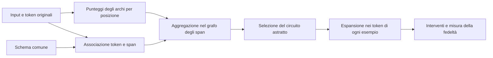
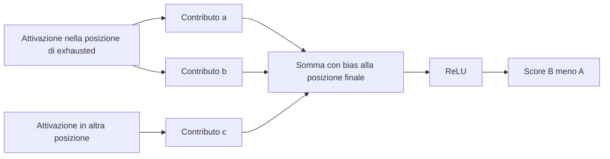

# Position-aware Automatic Circuit Discovery: spiegazione e applicazione ai lessici

**Paper:** Tal Haklay, Hadas Orgad, David Bau, Aaron Mueller e Yonatan Belinkov, *Position-aware Automatic Circuit Discovery*, ACL 2025, pp. 2792-2817. [Scheda e DOI](https://aclanthology.org/2025.acl-long.141/) · [PDF](https://aclanthology.org/2025.acl-long.141.pdf) · [Repository ufficiale PEAP](https://github.com/technion-cs-nlp/PEAP).

**Scopo di questa nota:** capire il metodo e tradurlo in un disegno sperimentale per la proposta di tesi sulla scoperta di circuiti guidata da lessici, con riferimento al task PHQ-8 su DAIC-WOZ del piano corrente. Le sezioni 2-7 spiegano il paper; le sezioni 8-15 propongono adattamenti da verificare, non risultati degli autori né esperimenti già eseguiti.

**Versione consultata:** pubblicazione ACL, verificata il 16 ottobre 2026. Questa è una spiegazione originale in italiano con esempi aggiuntivi. Il paper è distribuito dall'ACL con licenza [CC BY 4.0](https://creativecommons.org/licenses/by/4.0/), come indicato nella sua scheda.

## 1. La risposta alla tua domanda

**Sì: i lessici possono fornire una guida semantica alla ricerca di circuiti.** La formulazione precisa è però: *usare categorie semantiche esterne per orientare la scoperta di un meccanismo interno e verificarne il contributo mediante interventi*.

Il lessico indica **dove iniziare a cercare**; le attribuzioni e il patching stabiliscono **quali componenti e connessioni contribuiscono al comportamento del modello**. Il fatto che una parola appartenga alla categoria “sonno” non dimostra che una testa di attenzione elabori il concetto di sonno.

Il contributo del paper è particolarmente utile perché permette di distinguere una componente **nel punto del testo in cui opera**.

La stessa testa può svolgere funzioni diverse quando legge un'espressione pertinente, quando incontra una negazione e quando contribuisce alla risposta finale.

Bisogna distinguere tre significati di “ricerca semantica”:

| Operazione | Che cosa trova | Rapporto con la tesi |
|---|---|---|
| Matching lessicale | Parole o espressioni presenti in una risorsa | Produce le posizioni candidate; può usare categorie semantiche anche se il matching è letterale. |
| Ricerca per similarità semantica | Testi o rappresentazioni vicini a una descrizione, per esempio mediante embedding | Può ampliare i candidati oltre le parole note, ma aggiunge un metodo da validare. |
| Scoperta di circuiti guidata semanticamente | Componenti e connessioni interne rilevanti per un comportamento | È la direzione della tesi; richiede un modello accessibile e interventi interni. |

La denominazione più prudente iniziale è **scoperta di circuiti guidata da lessici semantici**. L'espressione “circuito semantico” richiede evidenze ulteriori di generalizzazione oltre le parole usate nella scoperta.

## 2. Che cos'è un circuito in questo lavoro

Un Transformer può essere rappresentato come un grafo di calcolo. Nel paper i nodi rappresentano embedding, teste di attenzione, MLP e logits; le connessioni descrivono come le informazioni passano tra questi elementi. Un circuito è un sottografo che conserva il comportamento studiato con meno elementi del grafo completo. [Paper, §2](https://aclanthology.org/2025.acl-long.141.pdf#page=2).

Un esempio **ipotetico**, non un risultato sperimentale:

```text
espressione nel testo
    -> componente che ne elabora una proprietà
    -> attenzione che trasferisce informazione a una posizione successiva
    -> componenti che integrano il contesto
    -> logits delle risposte
```

Il circuito non è una lista di parole importanti e nemmeno una lista di teste molto attive. Deve includere collegamenti che consentano all'informazione di raggiungere l'output.

“Minimo” è un obiettivo della scoperta: la procedura greedy del paper non dimostra di trovare l'unico circuito possibile o il minimo globale. Inoltre, il circuito è relativo a task, dati, metrica, granularità del grafo e intervento scelto.

## 3. Perché la posizione cambia la spiegazione

### 3.1 Una componente viene riutilizzata nel testo

Considera questi esempi didattici:

```text
I feel tired every day.
I do not feel tired anymore.
```

La parola `tired` compare in entrambi, ma la proposizione espressa cambia. Sapere che una testa è importante “nel complesso” non chiarisce se interviene sulla parola, sulla negazione o sulla posizione da cui viene prodotta la risposta.

In una rappresentazione non posizionale si seleziona una connessione fra componenti e la si conserva a tutte le posizioni. Una rappresentazione posizionale permette di selezionare la connessione solo dove serve. Le identità diventano, schematicamente:

```text
Non posizionale: componente u -> componente v
Posizionale:    (u, posizione i) -> (v, posizione j)
```

Le connessioni ammissibili dipendono dall'architettura: non tutte le coppie di componenti e posizioni sono collegate direttamente.

### 3.2 Due problemi dell'aggregazione prematura

Il paper mostra due effetti. [§2 e Figura 2](https://aclanthology.org/2025.acl-long.141.pdf#page=3).

**Cancellazione.** Un arco può avere un effetto di `+10` in una posizione e `-10` in un'altra. Sommando prima di decidere quali posizioni conservare si ottiene zero. Si perde l'informazione che entrambe le occorrenze hanno un effetto forte, ma opposto.

**Sovrastima dell'importanza diffusa.** Un arco con contributo `1` in venti posizioni può superare un arco con contributo `15` in una sola posizione. Il primo non è necessariamente irrilevante; il problema è che la graduatoria aggregata non distingue bene un passaggio molto localizzato da tanti contributi modesti.

Prendere i valori assoluti può ridurre la cancellazione, ma non risolve da solo la perdita dell'identità delle posizioni. PEAP mantiene questa informazione durante la scoperta.

## 4. Come funziona PEAP

PEAP significa **Position-aware Edge Attribution Patching**. Per capirlo conviene separare patching diretto, approssimazione e trattamento dell'attenzione.

### 4.1 Il patching diretto: una domanda causale locale

Si fissa un input `x`, una metrica scalare `m` e un riferimento `x'`. Durante l'esecuzione su `x`, si sostituisce il contributo di una connessione con quello ricavato dal riferimento. Si misura quanto cambia `m`:

$$
IE_x(e)=m(x\mid e\leftarrow e_{x'})-m(x).
$$

Questo è un intervento sul calcolo del modello: non richiede di cambiare il testo dell'esecuzione principale. Il riferimento serve a definire il valore sostitutivo. “Clean” e “corrupted” identificano condizioni sperimentali; non significano necessariamente risposta vera e risposta falsa.

Provare separatamente moltissimi archi con esecuzioni complete può essere costoso. EAP stima questi effetti usando gradienti. [Paper, §3, Eq. 1](https://aclanthology.org/2025.acl-long.141.pdf#page=4).

### 4.2 EAP: differenza di attivazione per sensibilità dell'output

Per un arco fra componenti alla stessa posizione:

$$
g_x(e)\approx(z_u^*-z_u)^\top\nabla_{z_{v,\mathrm{in}}}m(x).
$$

| Termine | Significato |
|---|---|
| `z_u` | Attivazione della componente sorgente nell'esecuzione originale. |
| `z_u*` | Attivazione sostitutiva, ricavata dal riferimento. |
| `z_u* - z_u` | Cambiamento introdotto dal patching. |
| Gradiente di `m` rispetto all'input di `v` | Sensibilità locale della metrica al contributo ricevuto. |
| Prodotto scalare | Stima di quanto il cambiamento modifica la metrica. |

Intuizione: una variazione interna è importante se si muove in una direzione alla quale l'output è sensibile.

È un'approssimazione locale. Non prova che un grande intervento abbia esattamente quell'effetto né che gli effetti di archi diversi siano additivi. Anche il segno va interpretato rispetto alla metrica e alla direzione dell'intervento: con la convenzione sopra, un valore negativo indica che la sostituzione riduce `m`.

### 4.3 PEAP: distinguere anche i passaggi fra posizioni

Nel Transformer autoregressivo l'attenzione permette a una posizione di usare informazione proveniente da posizioni precedenti. PEAP considera esplicitamente questi passaggi, oltre alle connessioni alla stessa posizione. [§3.1, Eq. 2-6](https://aclanthology.org/2025.acl-long.141.pdf#page=4).

Per una testa `h`, alla posizione di destinazione `t`, si considera una sorgente `j ≤ t`. Gli interventi distinguono contributi legati a:

- **Value:** il contenuto informativo proveniente dalla sorgente.
- **Key:** il contributo della sorgente alla distribuzione dell'attenzione.
- **Query:** il contributo della query di destinazione alla relazione con quella sorgente.

Il metodo ricalcola l'output locale della testa sotto l'intervento e usa il gradiente per stimarne l'effetto a valle:

$$
g_x(e)\approx(z_{h,t}^{\mathrm{patched}}-z_{h,t})^\top
\nabla_{z_{h,t}}m(x).
$$

**Dettaglio utile per una futura implementazione:** nell'Eq. 6 la query sostitutiva interviene nel termine della sorgente selezionata prima della softmax. Non equivale a sostituire indiscriminatamente l'intera query per tutte le sorgenti. La normalizzazione della softmax può comunque modificare più pesi di attenzione.

Gli archi di attenzione descritti qui riguardano il trasferimento all'interno della stessa testa e dello stesso layer tra posizioni. Le connessioni attraverso il residual stream collegano invece componenti successive. Non si aggiungono collegamenti arbitrari fra qualsiasi testa a qualsiasi posizione.

**Per la tesi:** conservare i punteggi di EAP-IG per token è utile, ma non riproduce automaticamente tutta PEAP. Occorre anche verificare quali archi tra posizioni siano rappresentati e come siano valutati.

## 5. Gli schemi: allineare ruoli invece di numeri di token

### 5.1 Il problema degli input di lunghezza diversa

In due testi differenti, il token numero 12 può essere una negazione oppure il nome di una persona. Fare la media dei contributi alla posizione 12 rischia quindi di mescolare operazioni diverse.

Il paper introduce un **dataset schema**: una segmentazione in span contigui con ruoli comuni tra esempi. Uno span può contenere uno o più token. Per esempio, un evento espresso con una parola e uno espresso con due parole possono occupare lo stesso ruolo nello schema. [§4 e Figure 4-5](https://aclanthology.org/2025.acl-long.141.pdf#page=5).

Lo schema può essere semantico, sintattico o guidato da proprietà del calcolo del modello. Non è obbligatoriamente un inventario di concetti psicologici.

### 5.2 Dal grafo concreto al grafo degli span

Il procedimento è:



La segmentazione non comprime il testo prima di darlo al modello: **il modello continua a elaborare i token originali**. È il grafo usato per organizzare la scoperta a essere astratto.

Indicando con `f_x(e)` l'insieme di archi concreti rappresentati da un arco dello schema, l'Eq. 8 aggrega così:

$$
g_S(e)=\frac{1}{|D|}\sum_{x\in D}\sum_{e'\in f_x(e)}g_x(e').
$$

Si sommano i contributi degli archi rappresentati dallo stesso arco astratto e si fa la media tra esempi. Alla valutazione, il circuito astratto viene espanso nelle posizioni effettive di ciascun input. [§4.1, Eq. 7-9](https://aclanthology.org/2025.acl-long.141.pdf#page=6).

Due conseguenze importanti:

- Il raggruppamento riduce la risoluzione: cancellazioni possono ancora verificarsi dentro uno span o tra esempi. La granularità dello schema conta.
- Un arco astratto può rappresentare numeri diversi di archi concreti. Per confrontare le dimensioni non basta contare gli archi dello schema.

### 5.3 Il vincolo più importante per le interviste

**Nel paper gli span devono coprire il prompt e mantenere lo stesso ordine tra gli esempi.** Ogni token appartiene a uno span. Gli autori indicano esplicitamente l'ordine comune come un limite. [§4.2 e Limitations](https://aclanthology.org/2025.acl-long.141.pdf#page=9).

Queste due interviste, per esempio, non condividono automaticamente lo schema ordinato delle categorie:

```text
Intervista A: sonno -> energia -> interesse
Intervista B: interesse -> sonno -> energia -> sonno
```

Non basta assegnare etichette `SONNO`, `ENERGIA`, `INTERESSE` per ottenere lo schema richiesto da PEAP. Riordinare il testo per forzarlo nello schema cambierebbe il comportamento da spiegare.

## 6. Automazione degli schemi e costruzione del circuito

### 6.1 Che cosa fa l'LLM nella pipeline

L'LLM ausiliario propone uno schema e lo applica ai testi. Gli autori generano tre candidati da sottocampioni, li unificano e controllano che lo schema sia applicabile. Separano validità strutturale e correttezza rispetto all'applicazione umana. [§4.2](https://aclanthology.org/2025.acl-long.141.pdf#page=6).

La variante **LLM+Mask** fornisce anche una maschera di importanza dei token ricavata con input×gradient dal modello analizzato. L'idea è suggerire al generatore di separare posizioni che contano per il calcolo. Nel paper la maschera seleziona posizioni il cui punteggio normalizzato via softmax supera `1/n`, con `n` lunghezza del prompt.

Questa maschera è diversa dalla maschera lessicale della tesi: la prima deriva dal modello, la seconda da una risorsa esterna. Sono due fonti informative confrontabili, non sinonimi.

Gli autori usano Claude 3.5 Sonnet con successo nella loro configurazione; questo dato storico non implica che sia oggi la scelta migliore o necessaria per replicare l'idea. Il modello che annota gli span va distinto da GPT-2 o Llama-3, di cui si studiano i circuiti.

### 6.2 Come vengono selezionati gli archi

Non basta scegliere gli archi con valore assoluto più alto: si potrebbero ottenere pezzi scollegati. L'Appendice C descrive una ricerca greedy che parte dal nodo dei logits finali e aggiunge archi entranti ad alto punteggio connessi al circuito già costruito. Rimuove poi elementi privi di collegamento con gli embedding. [Appendice C](https://aclanthology.org/2025.acl-long.141.pdf#page=16).

La lezione applicativa è che **un filtro lessicale deve lasciare spazio alle connessioni necessarie per arrivare all'output**, anche quando attraversano posizioni non presenti nel lessico.

## 7. Esperimenti, risultati e limiti del paper

### 7.1 Che cosa viene studiato

| Task | Comportamento analizzato | Modelli |
|---|---|---|
| Greater-Than | Completare un anno coerente con un confronto numerico | GPT-2 small |
| Indirect Object Identification, IOI | Identificare il destinatario corretto in frasi con più persone | GPT-2 small e Llama-3-8B |
| WinoBias | Risoluzione di coreferenze in una configurazione che studia risposte distorte da bias | Llama-3-8B |

Gli esperimenti prevedono 500 esempi per la scoperta e altri 500 per la valutazione. Per IOI e Greater-Than vengono usati esempi su cui il modello risponde correttamente; per WinoBias viene analizzato un sottoinsieme con risposte errate dovute al bias, usando mean ablation come riferimento. **La fedeltà può quindi conservare anche un errore del modello.** [§3.2 e §5](https://aclanthology.org/2025.acl-long.141.pdf#page=7).

### 7.2 Come viene misurata la fedeltà

La **soft faithfulness** confronta il valore della metrica del circuito con quello del modello completo:

$$
F_S(C)=\frac{\mathcal{M}(C)}{\mathcal{M}(F)}.
$$

Qui `F` indica il modello completo e `𝓜` la metrica del task aggregata sul dataset. La **hard faithfulness** misura l'accordo sulla predizione del token finale, mediato sugli esempi. [§3.2](https://aclanthology.org/2025.acl-long.141.pdf#page=5).

Il rapporto soft non è automaticamente limitato a `[0,1]` e diventa poco interpretabile se il denominatore è vicino a zero. Per il task binario della tesi conviene aggiungere distanze dirette fra probabilità e score, anziché trasferire il rapporto senza controlli.

### 7.3 Che cosa supportano i risultati

La Figura 6 mostra un compromesso dimensione-fedeltà migliore per i circuiti posizionali rispetto a quelli non posizionali. Gli schemi LLM+Mask raggiungono risultati comparabili a quelli umani e in alcuni casi migliori. Nel confronto si riporta il numero medio di archi concreti dopo l'espansione, perché le lunghezze degli span variano. [§5.2-6, Figura 6](https://aclanthology.org/2025.acl-long.141.pdf#page=8).

Il lavoro **non dimostra** che un lessico psicologico migliori la scoperta, che PEAP funzioni direttamente sulle interviste DAIC-WOZ o che circuiti più piccoli siano automaticamente più rapidi da trovare. Non studia neppure la generalizzazione semantica nel senso forte richiesto dalla tua domanda: stessa capacità su parafrasi senza le voci del lessico.

## 8. Tre modi di collegare i lessici a PEAP

Da qui in avanti le scelte sono **proposte per la tesi**.

| Variante | Uso del lessico | Vantaggio e limite |
|---|---|---|
| **A. Lessico per costruire gli span** | Individua espressioni e confini nello schema PEAP | Adattamento vicino al paper; richiede una struttura ordinata condivisa. |
| **B. Lessico per dare priorità alla ricerca** | Favorisce candidati associati alle posizioni lessicali mantenendo esplorazione globale | Più adatto alle interviste libere; non richiede di unificare tutte le categorie in uno schema PEAP. |
| **C. Lessico per annotare il circuito trovato** | Associa categorie a posizioni e componenti dopo una scoperta indipendente | Utile per descrivere il risultato, ma non dimostra che il lessico aiuti la ricerca. |

Per il piano attuale partirei da **B**, usando **A** come esperimento controllato su testi con struttura compatibile. Questo conserva la domanda sulla guida lessicale senza dover risolvere subito il problema degli schemi arbitrariamente riordinabili.

### 8.1 Un esempio compatibile con la variante A

Su un dataset costruito con un ordine fisso si potrebbe adottare:

```text
ISTRUZIONE | DOMANDA | CONTESTO_PRIMA | ESPRESSIONE_TARGET | CONTESTO_DOPO | SUFFISSO
```

Il lessico aiuta a localizzare `ESPRESSIONE_TARGET`; gli altri span garantiscono la copertura del testo. La categoria dell'espressione resta un attributo, per esempio `sonno` o `energia`. Le due parti di contesto conservano anche negazioni e marcatori temporali.

Se ci sono più occorrenze, occorre una regola prefissata o schemi distinti. Scegliere soltanto la prima occorrenza può perdere informazione: è una restrizione da misurare, non una soluzione universale.

Il README ufficiale descrive span mediante indici iniziali dei token, una colonna `prompt` e una colonna `length`; permette span vuoti e richiede attenzione all'indice del BOS. Gli span vuoti non risolvono l'inversione dell'ordine tra categorie. [README PEAP, “How to Add New Tasks”](https://github.com/technion-cs-nlp/PEAP#how-to-add-new-tasks).

## 9. Dal lessico alle posizioni: un esempio concreto

Considera questo testo sintetico, senza attribuirgli una label clinica:

```text
Ellie: How have you been sleeping?
Participant: I wake up several times and feel exhausted in the morning.
```

Un lessico di lavoro può riconoscere `wake up` e `exhausted`, rispettivamente come candidati legati a sonno ed energia. L'annotazione esterna potrebbe essere:

| Informazione | Esempio |
|---|---|
| Span lessicale | `exhausted` |
| Categoria proposta | Energia |
| Parlante | Partecipante |
| Persona a cui è riferita l'esperienza | Sé |
| Negazione | Assente nella proposizione |
| Tempo e contesto | `in the morning` |
| Posizioni utilizzabili | Offset di caratteri convertiti in indici del tokenizer effettivo |

Questi metadati servono alla procedura di ricerca. **Non vanno automaticamente inseriti nel prompt**, perché si spiegherebbe un input diverso da quello originale.

Il matcher dovrebbe gestire espressioni di più parole, flessioni, sovrapposizioni e polisemia con regole documentate. Non è necessario risolvere perfettamente tutto nel pilot, ma serve un campione revisionato che renda visibili gli errori.

Il testo pertinente può essere distribuito su più subtoken. Usare offset del tokenizer è più affidabile che trattare le parole separate da spazi come se fossero token. Domande dell'intervistatrice e risposte del partecipante devono restare distinguibili: “How have you been sleeping?” può contenere una voce del lessico senza essere un'esperienza riferita dal partecipante.

## 10. Una guida lessicale concreta per la ricerca

### 10.1 Prima fissare il comportamento

Nel piano corrente il task è binario. Si può usare uno score differenziabile:

$$
s(x)=\mathrm{logit}_{c_1}(x)-\mathrm{logit}_{c_0}(x),
$$

con simboli di classe verificati come singoli token. Si congelano modello, prompt, tokenizer, output target e soglia prima di confrontare le strategie. Le categorie lessicali non assegnano automaticamente la classe al testo.

### 10.2 Il lessico modifica la priorità, non il valore causale misurato

Sia `a_x(e)` la magnitudine dell'attribuzione di un candidato nell'esempio `x`. Si definisce un indicatore `w_x(e)` che vale 1 se il candidato tocca una posizione lessicale o un contesto ammesso dalla regola, e 0 altrimenti.

Per archi alla stessa posizione si controlla quella posizione; per archi di attenzione si possono controllare sorgente e destinazione. Per i percorsi si considera l'insieme delle posizioni attraversate. La scelta esatta deve essere la stessa in tutte le repliche.

Una possibile implementazione con candidati allineabili tra esempi è:

$$
A(e)=\frac{1}{|D|}\sum_x a_x(e),\qquad
L(e)=\frac{1}{|D|}\sum_x w_x(e)a_x(e).
$$

$$
P_\lambda(e)=(1-\lambda)R_A(e)+\lambda R_L(e),
\qquad 0\leq\lambda<1.
$$

`R_A` e `R_L` sono trasformazioni in ranghi normalizzati comparabili, con valori maggiori per candidati più prioritari. La gestione degli zeri e dei pareggi va prefissata. `λ` si sceglie sul development. **Questa formula è una proposta, non la formula PEAP.**

Per interviste senza un allineamento condiviso, non si può fare direttamente la media di “arco al token 20” tra esempi. Una prima implementazione può ordinare candidati per esempio e aggregare con una mappa di ruoli dichiarata; in alternativa può aggregare a livello di componenti, mantenendo separata la quota di attribuzione proveniente dalle posizioni lessicali. Quest'ultima scelta ha meno risoluzione di un circuito pienamente posizionale e va chiamata correttamente.

**Maschera binaria o categorie?** Se `w` indica soltanto “presente in qualunque categoria”, la ricerca usa la localizzazione del lessico, ma non distingue sonno da energia. Per dimostrare un beneficio delle categorie servirebbe un'estensione, per esempio graduatorie `L_k` per categoria con quote di esplorazione prefissate. È una domanda aggiuntiva, non un risultato implicito della maschera binaria.

### 10.3 Conservare l'esplorazione globale

La priorità combinata può essere accompagnata da una quota esplicita di proposte dalla graduatoria globale, fissata sul development. Una semplice miscela di ranghi non garantisce che un candidato fuori dal lessico venga esaminato con budget piccolo.

In ogni caso, la selezione deve rispettare la connessione con l'output e consentire passaggi fuori dagli span lessicali. Il modello potrebbe raccogliere l'informazione su punteggiatura, token di fine turno o altre posizioni prive di significato lessicale diretto.

### 10.4 Separare screening e verifica

La guida ordina i candidati. Il patching verifica gli effetti usando la metrica originale e riferimenti comuni tra strategie. Non si moltiplica l'effetto verificato per un peso lessicale per poi dichiarare che il circuito è più fedele.

Pseudocodice concettuale, non API eseguibile:

```text
fissa modello, dati, metrica, riferimenti e budget
annota span lessicali e contesto senza modificare gli input
calcola le attribuzioni con una procedura comune alle strategie
costruisci priorità globale e priorità lessicale

finché rimane budget:
    proponi candidati rispettando connettività ed esplorazione globale
    verifica gli effetti con interventi interni
    aggiorna il circuito secondo una regola comune

misura il comportamento congiunto del circuito
seleziona iperparametri sul development
congela circuito e regola di applicazione
valuta su partecipanti nuovi e parafrasi
```

L'eventuale uso di IPE previsto dal piano riguarda la verifica dei percorsi. PEAP, EAP-IG e IPE non sono intercambiabili: rappresentazione del grafo, stima degli effetti e selezione dei percorsi devono essere compatibili. In un primo studio si può fermarsi agli archi e al patching diretto se la parte sui percorsi è troppo costosa.

## 11. Che cosa serve per parlare di generalizzazione semantica

Un circuito scoperto usando `exhausted` potrebbe dipendere dalla forma lessicale, oppure contribuire a un comportamento che si ritrova con espressioni diverse. Per distinguere le possibilità servono coppie controllate.

| Condizione | Esempio sintetico | Domanda |
|---|---|---|
| Esplicita | `I feel exhausted every morning.` | Il circuito è fedele sulla forma usata nella scoperta? |
| Parafrasi | `Even getting dressed in the morning takes all the effort I have.` | Resta fedele quando il contenuto è espresso diversamente? |
| Negazione | `I do not feel exhausted anymore.` | Riproduce la variazione contestuale del modello? |
| Altra persona | `My brother feels exhausted every morning.` | Distingue a chi è riferita l'esperienza, se lo fa il modello? |
| Passato | `Last year I felt exhausted every morning; now I feel fine.` | Conserva la sensibilità alla temporalità? |

La parafrasi proposta va revisionata: non basta che sembri plausibile per garantire equivalenza. Va inoltre verificato automaticamente che non contenga voci del lessico congelato, comprese le varianti previste dal matcher.

Per confrontare modello `F` e circuito `C`, considera:

$$
E_{\Delta}=\left|
\big[s_F(x')-s_F(x)\big]
-\big[s_C(x')-s_C(x)\big]
\right|.
$$

Il circuito dovrebbe riprodurre il cambiamento del modello. Non bisogna imporre che il cambiamento sia clinicamente corretto: quella è una diversa valutazione del predittore. Se il modello non distingue affermazione e negazione, un circuito fedele può riprodurre proprio tale limite.

### Il problema della mappa sul test

**Congelare il circuito non basta: va congelata anche la regola che lo applica al nuovo testo.** Se lo span target esiste solo quando compare una voce del lessico, una parafrasi priva di match potrebbe diventare impossibile da mappare.

Sono possibili due valutazioni distinte:

1. **Pipeline completa:** si usa la stessa annotazione automatica congelata. I fallimenti di copertura si riportano come tali e non si eliminano dal test.
2. **Circuito con allineamento controllato:** si fornisce una mappa manuale del ruolo semantico, definita senza consultare gli effetti interni. Serve a separare un limite del matcher da un limite del circuito; non misura la prestazione interamente automatica.

Non si deve riscoprire il circuito sulle parafrasi di test: altrimenti si misura una nuova scoperta, non il trasferimento del circuito originale.

## 12. Riferimenti di patching e allineamento

Due frasi semanticamente simili possono avere lunghezze e tokenizzazioni diverse. Lo schema aiuta ad aggregare gli effetti, ma **non definisce automaticamente quale attivazione usare come sostituto di ogni token**.

Per il pilot:

- Usare coppie con struttura e tokenizzazione controllabili per verificare la correttezza degli interventi.
- Esplicitare l'allineamento dei siti patchati: indici, ruoli, oppure medie per ruolo definite sui dati di scoperta.
- Confrontare, quando sostenibile, un riferimento controfattuale e una mean ablation, riconoscendo che rispondono a domande diverse.
- Verificare che patchare un'attivazione con sé stessa non cambi l'output e che il grafo completo ricostruisca l'esecuzione originale.

Una media per ruolo su testi liberi è una scelta metodologica da validare: può produrre attivazioni poco naturali. Un riferimento neutralizzato male può mescolare cambiamenti di significato, stile e grammatica. L'effetto trovato resta relativo a quel riferimento.

## 13. Disegno sperimentale minimo per la tesi

### 13.1 Confronti che isolano il contributo del lessico

| Condizione | Funzione |
|---|---|
| Ricerca globale | Stessa procedura senza informazione lessicale. |
| Guida lessicale | Variante principale. |
| Maschere casuali abbinate | Controllo per numero, lunghezza, posizione e frequenza degli span selezionati. |
| Guida da salienza | Controllo con informazione ricavata direttamente dal modello. |
| PEAP con schema compatibile | Confronto metodologico su un sottoinsieme strutturato e comune. |
| Guida lessicale rigida, opzionale | Quantifica ciò che si perde impedendo l'esplorazione fuori dal lessico. |

Le prime quattro condizioni dovrebbero condividere grafo, screening, riferimenti, regola di verifica e budget. Confrontare una variante con grafi posizionali e una con grafi non posizionali senza ulteriori controlli confonderebbe il beneficio del lessico con quello della rappresentazione.

Se si introducono priorità specifiche per categoria, aggiungere un controllo che rimescoli le categorie mantenendo gli span. Se la guida è solo binaria, tale rimescolamento non cambia nulla e non è un controllo informativo.

### 13.2 Metriche

Per la probabilità della classe target, una metrica primaria coerente con il piano è:

$$
E_{\mathrm{fid}}(C)=\frac{1}{N}\sum_{i=1}^{N}
\left|p_F(x_i)-p_C(x_i;r)\right|.
$$

Qui `r` è il riferimento di intervento e `N` il numero di partecipanti se si ha un output per intervista. In presenza di più estratti, prima si aggrega secondo una regola prefissata per partecipante. Un valore minore indica maggiore fedeltà.

Riportare inoltre:

- Distanza degli score e accordo delle classi, per non affidarsi a una sola metrica.
- Numero di archi concreti attivi, con media e dispersione quando variano tra input.
- Tempo, memoria, numero di interventi e costo di preparazione della guida.
- Fedeltà su parafrasi, casi senza match e categorie distinte.
- Incertezza con confronti appaiati e bootstrap per partecipante, oltre a repliche della scoperta.

**Fedeltà e qualità predittiva restano separate:** la prima confronta circuito e modello; la seconda confronta il modello con le etichette del dataset. Il lessico può aiutare a riprodurre anche una scorciatoia del predittore.

### 13.3 Quando si può sostenere un risparmio

Se si calcolano comunque tutte le attribuzioni, il lessico non ha ridotto quel costo. Può ridurre il numero di interventi successivi, favorire un arresto anticipato o produrre un circuito più compatto. Sono risultati diversi.

Per la domanda sull'efficienza serve una curva **errore di fedeltà contro costo totale**, a dimensione del circuito controllata. Per la compattezza serve la curva **errore contro numero di archi**. Una migliore curva di compattezza non implica automaticamente un minor tempo di scoperta.

### 13.4 Sequenza operativa collegata al piano corrente

| Fase | Attività | Criterio per proseguire |
|---|---|---|
| E0 | Lessico documentato, annotazioni e split per partecipante | Matcher valutabile e copertura misurata anche sui casi difficili. |
| E1 | Replica tecnica semplice e pilot su estratti brevi | Interventi corretti, modello non degenere e costo sostenibile. |
| E2 | Ricerca globale, lessicale, casuale e da salienza | Confronti sullo stesso dataset e budget; nessuna selezione sul test. |
| E3 | Partecipanti nuovi e parafrasi | Circuito e regole congelati; copertura e fedeltà riportate insieme. |
| E4 | Negazione, persona e temporalità | Distinzione fra sensibilità del modello e capacità del circuito di riprodurla. |
| E5 | Repliche e riferimenti alternativi | Vantaggio non spiegato solo da copertura, dimensione o scelta del riferimento. |

Un pilot può iniziare con un modello piccolo e contesti brevi, come previsto nel piano. Se si usano estratti, la selezione deve essere comune alle strategie e indipendente dalla guida lessicale. I risultati riguarderanno il predittore sugli estratti, non automaticamente il modello sull'intervista completa.

## 14. Come usare il codice ufficiale senza dare per risolta l'integrazione

Il repository PEAP costituisce un punto di partenza per la replica. Il README documenta il formato degli span e le componenti di attribuzione e valutazione. Non è stata eseguita una replica in questa attività. [Repository ufficiale](https://github.com/technion-cs-nlp/PEAP).

Prima di adattarlo a DAIC-WOZ occorre verificare:

1. La compatibilità del checkpoint scelto con accesso alle attivazioni, gradienti e rappresentazione dell'attenzione.
2. La corrispondenza fra tokenizzazione effettiva, BOS, eventuale chat template e confini degli span.
3. Il calcolo dello score binario nel punto esatto di predizione.
4. Il riferimento di patching e la ricostruzione del circuito completo.
5. La memoria richiesta dai collegamenti tra posizioni: il numero di coppie ammissibili cresce quadraticamente con la lunghezza della sequenza per ogni testa/layer pertinente.

La verifica del codice è distinta dalla lettura del README: nomi di classi, argomenti e compatibilità con il task vanno controllati sulla revisione che si sceglierà di usare. Non serve introdurre subito un LLM annotatore: per il primo esperimento uno schema manuale verificabile o un matcher deterministico rende più chiara l'origine degli errori.

## 15. Quale contributo potrebbe sostenere la tesi

Il paper fornisce già un precedente per **posizioni, span semantici e aggregazione della scoperta**. La novità non può consistere soltanto nel dire che si usano span significativi.

Una domanda più specifica e verificabile è:

> A parità di grafo, procedura di intervento, budget e dimensione, la conoscenza di un lessico esterno migliora la scoperta di circuiti fedeli a un predittore, e il vantaggio si conserva su persone nuove e formulazioni non presenti nel lessico?

| Esito | Interpretazione sostenibile |
|---|---|
| Migliore fedeltà allo stesso costo e trasferimento alle parafrasi | Evidenza a favore della guida lessicale nelle condizioni studiate. |
| Vantaggio soltanto sulle parole note | Utilità lessicale, con generalizzazione limitata. |
| Prestazioni equivalenti a maschere casuali abbinate | Beneficio forse dovuto a copertura o localizzazione generica, non all'informazione del lessico. |
| Nessun vantaggio rispetto alla salienza | Il lessico può essere ridondante rispetto alla guida ricavata dal modello. |
| Circuiti diversi per categorie | Ipotesi da verificare con interventi incrociati; non dimostrazione di moduli semantici separati. |
| Risultato molto variabile tra repliche | Evidenza insufficiente per una conclusione forte. |

**La proposta operativa è usare il lessico come priorità morbida, conservare l'informazione posizionale disponibile e verificare causalmente i candidati.** PEAP chiarisce perché “in quale punto del testo” fa parte della spiegazione; gli esperimenti con lessici devono chiarire se una conoscenza semantica esterna rende quella spiegazione più facile da trovare e più trasferibile.

## 16. Guida alla rilettura e fonti

| Parte del paper | Domanda a cui risponde |
|---|---|
| §2, Figura 2 | Che cosa si perde sommando le posizioni? |
| §3, Eq. 1-6 | Come vengono stimati gli effetti degli archi, inclusi quelli di attenzione? |
| §4.1, Figura 5, Eq. 7-9 | Come si passa da token a span e poi di nuovo ai token? |
| §4.2 | Come vengono generati, applicati e valutati gli schemi? |
| §5-6, Figura 6 | Su quali task e modelli è sostenuto il beneficio? |
| Limitations | Perché ordine e struttura degli span limitano il trasferimento alle interviste? |
| Appendice C | Perché la selezione deve preservare la connettività? |

**Fonti primarie:** [pubblicazione ACL e metadati](https://aclanthology.org/2025.acl-long.141/), [testo PDF](https://aclanthology.org/2025.acl-long.141.pdf), [README e codice ufficiale PEAP](https://github.com/technion-cs-nlp/PEAP). La spiegazione del metodo si basa sulla versione ACL, non soltanto sull'abstract. Esempi sulle interviste, priorità lessicale, controlli e protocollo sono elaborazioni proposte in questa nota.

**Contesto locale utilizzato:** la proposta 00 e gli esperimenti E0-E5 nel piano di tesi corrente; la nota bibliografica del 16 ottobre 2026. Il presente documento approfondisce il collegamento metodologico senza modificare quelle proposte.

## 17. Esempio numerico completo: da un token lessicale a un circuito

### 17.1 Che cosa rappresenta l'esempio

Questo è un grafo giocattolo con valori inventati, non un esperimento su DAIC-WOZ e non un'implementazione completa di PEAP. Serve a rendere espliciti i calcoli di attribuzione, la selezione guidata dal lessico e la verifica del circuito.

Il modello deve scegliere tra due simboli di classe `A` e `B` alla fine del prompt:

```text
Intervista: ... I feel exhausted every morning. ...
Classe:
```

Lo score è `s = logit(B) - logit(A)`, misurato dopo `Classe:`. Non studiamo la previsione della parola che segue `exhausted` dentro l'intervista.

Il matcher trova `exhausted` e il tokenizer ne identifica la posizione `i`; per semplicità supponiamo un solo token. I metadati esterni danno `m_i = 1`. Un'altra posizione `j`, non coperta dal lessico, ha `m_j = 0`.

Supponiamo di osservare durante il forward due attivazioni scalari:

$$
z_i=2,\qquad z_j=1.
$$

Il lessico non produce questi numeri: vengono dall'esecuzione del modello. Le attivazioni reali sono generalmente vettori. Qui non attribuiamo un significato psicologico ai due scalari.

### 17.2 Un piccolo grafo con tre contributi candidati

Il modello giocattolo ha parametri fissati e tre contributi:

$$
a=0.8z_i,\qquad b=0.1z_i,\qquad c=0.6z_j.
$$

Alla posizione finale `T` li combina così:

$$
q_T=a+b+c-0.5,\qquad h_T=\operatorname{ReLU}(q_T),
\qquad s=2h_T-1.
$$

`ReLU(q) = max(0,q)`. I numeri `0.8`, `0.1`, `0.6`, `-0.5`, `2`, `-1` sono parametri del modello inventato, non pesi assegnati dal lessico.



Le tre branche sono macro-collegamenti didattici. In un Transformer il trasferimento tra posizioni richiederebbe archi di attenzione espliciti, con relativi Q, K e V. Questo esempio non calcola quegli archi; assume già disponibili i tre candidati nel piccolo grafo.

Con i valori osservati:

$$
a=0.8\cdot2=1.6,\qquad b=0.1\cdot2=0.2,
\qquad c=0.6\cdot1=0.6.
$$

$$
q_T=1.6+0.2+0.6-0.5=1.9,
\qquad h_T=1.9,
\qquad s_F=2\cdot1.9-1=\boxed{2.8}.
$$

Nella softmax ristretta alle due classi, `p(B) = sigmoid(s_F) ≈ 0.9427`. Non è una probabilità clinicamente calibrata.

### 17.3 Il lessico individua i candidati iniziali

Poiché `m_i = 1`, esploriamo inizialmente le branche `a` e `b`, entrambe originate dalla posizione `i`. Non conosciamo ancora la loro importanza e non le includiamo automaticamente nel circuito.

La branca `c` rimane disponibile nella ricerca globale. Nei grafi reali la connettività si conosce dall'architettura e dagli strumenti di accesso al modello; il lessico seleziona posizioni, non inventa collegamenti.

### 17.4 Calcolo dell'attribuzione dei singoli archi

Scegliamo come riferimento l'azzeramento del contributo dell'arco. È una scelta esplicita per semplificare l'esempio, non la raccomandazione universale per il modello reale.

Definiamo l'effetto della rimozione:

$$
IE(e)=s_{e\leftarrow0}-s_F.
$$

La stima tramite gradiente è:

$$
g(e)=(0-v_e)\frac{\partial s}{\partial v_e},
$$

dove `v_e` è il contributo trasportato dall'arco (`a`, `b` o `c`). Questa è la forma scalare della logica di attribution patching; la formulazione generale usa un prodotto scalare tra variazione di attivazione e gradiente. [Paper, §3, Eq. 1](https://aclanthology.org/2025.acl-long.141.pdf#page=4).

Nel forward originale `q_T = 1.9 > 0`, quindi la derivata della ReLU è 1:

$$
\frac{\partial s}{\partial a}
=\frac{\partial s}{\partial b}
=\frac{\partial s}{\partial c}=2.
$$

Di conseguenza:

$$
g(a)=(0-1.6)\cdot2=\boxed{-3.2},
$$

$$
g(b)=(0-0.2)\cdot2=\boxed{-0.4},
\qquad
g(c)=(0-0.6)\cdot2=\boxed{-1.2}.
$$

I valori assoluti suggeriscono che `a` sia il candidato più importante, seguito da `c` e poi da `b`. Il segno negativo indica che azzerare il contributo riduce lo score verso `B`.

Si può verificare direttamente, per esempio per `a`:

$$
s_{a\leftarrow0}
=2\max(0,0+0.2+0.6-0.5)-1
=2\cdot0.3-1=-0.4.
$$

$$
IE(a)=-0.4-2.8=\boxed{-3.2}.
$$

| Arco azzerato | Score dopo l'intervento | Effetto esatto | Stima con gradiente |
|---|---:|---:|---:|
| `a` | -0.4 | -3.2 | -3.2 |
| `b` | 2.4 | -0.4 | -0.4 |
| `c` | 1.6 | -1.2 | -1.2 |

Qui le stime coincidono con gli effetti esatti perché ciascuno di questi interventi mantiene la ReLU nel tratto lineare positivo. Non è una proprietà garantita in generale.

Non si devono confondere l'arco `a` e l'intera attivazione `z_i`: azzerare `z_i` modifica contemporaneamente `a` e `b`, mentre azzerare soltanto `a` lascia `b` invariato. Interventi su nodi e archi rispondono a domande differenti.

### 17.5 Come il lessico entra nella priorità numerica

Per mostrare una guida morbida, definiamo un bonus `L(a)=L(b)=1`, `L(c)=0`, e una regola illustrativa:

$$
P(e)=|g(e)|\,[1+\lambda L(e)],\qquad \lambda=0.5.
$$

È una regola proposta per l'esempio, non una formula del paper. `λ` in un esperimento reale andrebbe scelto sul development.

$$
P(a)=3.2\cdot1.5=4.8,\qquad
P(b)=0.4\cdot1.5=0.6,\qquad
P(c)=1.2\cdot1=1.2.
$$

L'ordine diventa `a`, `c`, `b`. Nonostante il bonus, il debole collegamento lessicale `b` non supera `c`. Si possono quindi esplorare per prime le posizioni lessicali senza imporre di includere tutte le loro branche prima delle altre.

Questo calcolo presuppone che siano disponibili anche le attribuzioni dei candidati globali. Non dimostra alcun risparmio nello screening; mostra come combinare informazioni per dare priorità alla verifica.

### 17.6 Costruzione e verifica congiunta del circuito

Conserviamo sempre i nodi di somma, ReLU e output, i loro bias e i collegamenti di uscita. Cerchiamo quali delle tre branche entranti mantenere; le altre vengono azzerate. Quindi `C = {a,c}` è una notazione abbreviata per un sottografo connesso completo di tali elementi comuni.

Fissiamo una tolleranza didattica sull'errore dello score:

$$
E(C)=|s_F-s_C|\leq\varepsilon,\qquad \varepsilon=0.5.
$$

**Primo candidato: mantenere soltanto `a`.**

$$
s_{\{a\}}=2\max(0,1.6-0.5)-1=1.2.
$$

$$
E(\{a\})=|2.8-1.2|=1.6>0.5.
$$

Il primo percorso lessicale è importante, ma da solo non riproduce sufficientemente il modello.

**Secondo candidato: aggiungere `c`, che proviene da una posizione non lessicale.**

$$
s_{\{a,c\}}=2\max(0,1.6+0.6-0.5)-1=2.4.
$$

$$
E(\{a,c\})=|2.8-2.4|=\boxed{0.4}\leq0.5.
$$

Il circuito raggiunge la tolleranza scelta. La branca lessicale debole `b` può rimanere esclusa.

| Branche conservate | Score del circuito | Errore rispetto al modello |
|---|---:|---:|
| Nessuna | -1.0 | 3.8 |
| `a` | 1.2 | 1.6 |
| `b` | -1.0 | 3.8 |
| `c` | -0.8 | 3.6 |
| `a,b` | 1.6 | 1.2 |
| **`a,c`** | **2.4** | **0.4** |
| `b,c` | -0.4 | 3.2 |
| `a,b,c` | 2.8 | 0.0 |

In questo spazio minuscolo abbiamo verificato anche tutte le alternative: nessuna singola branca soddisfa la soglia e `a,c` è l'unica coppia che la soddisfa. Possiamo quindi parlare di minimo numero di branche per questo input, riferimento e soglia. Questa conclusione non si estende automaticamente a un Transformer o a tutto il dataset.

**Perché non basta sommare gli effetti individuali:** le tre rimozioni separate valgono `-3.2 - 0.4 - 1.2 = -4.8`. Ma rimuoverle insieme porta lo score da `2.8` a `-1`, cioè un effetto di `-3.8`. La ReLU attraversa lo zero e l'approssimazione lineare iniziale non descrive più l'intero intervento. Questo è il motivo per cui il circuito va eseguito e valutato congiuntamente.

### 17.7 Applicare lo stesso circuito a nuovi esempi

Congeliamo le branche `a,c` e la regola di mappatura dei ruoli `i,j`. Supponiamo, solo per il giocattolo, che tale corrispondenza sia già disponibile sui nuovi esempi.

Le funzioni diventano:

$$
s_F(z_i,z_j)=2\max(0,0.9z_i+0.6z_j-0.5)-1,
$$

$$
s_C(z_i,z_j)=2\max(0,0.8z_i+0.6z_j-0.5)-1.
$$

| Esempio | `z_i` | `z_j` | Score completo | Score circuito | Errore |
|---|---:|---:|---:|---:|---:|
| Scoperta | 2.0 | 1.0 | 2.80 | 2.40 | 0.40 |
| Nuovo 1 | 1.5 | 0.8 | 1.66 | 1.36 | 0.30 |
| Nuovo 2 | 0.5 | 1.2 | 0.34 | 0.24 | 0.10 |

Per esempio, sul Nuovo 1:

$$
s_F=2(0.9\cdot1.5+0.6\cdot0.8-0.5)-1=1.66,
$$

$$
s_C=2(0.8\cdot1.5+0.6\cdot0.8-0.5)-1=1.36.
$$

L'errore medio sui soli due nuovi esempi è `(0.30 + 0.10)/2 = 0.20`. Anche questi valori sono inventati: illustrano la valutazione di un circuito congelato, non provano generalizzazione su interviste reali. Una mappa basata solo sui match lessicali non sarebbe automaticamente applicabile a parafrasi prive di match.

### 17.8 Che cosa abbiamo imparato sul ruolo del lessico

Il lessico ha fornito `m_i = 1`, quindi un punto di ingresso nella ricerca. I parametri e le attivazioni hanno fornito i contributi numerici; il gradiente ha suggerito quali archi verificare; gli interventi hanno misurato gli effetti; la valutazione congiunta ha determinato quali branche conservare.

Il risultato non è “il circuito dell'energia”: è un circuito che approssima lo score del task e che include un percorso dalla posizione di `exhausted`, insieme a un contributo da un'altra posizione.

**Questo esempio non dimostra un vantaggio di costo del lessico:** la graduatoria globale `|g|` avrebbe già dato l'ordine `a,c,b`. Per dimostrare un risparmio bisogna osservare, su problemi reali e con controlli, che la guida raggiunge la stessa fedeltà con meno verifiche o minor costo totale. Un esempio corretto può mostrare come funziona la procedura anche quando il beneficio della guida è nullo.
